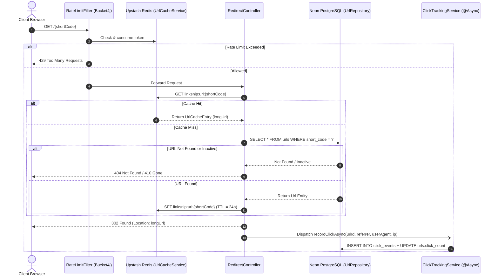
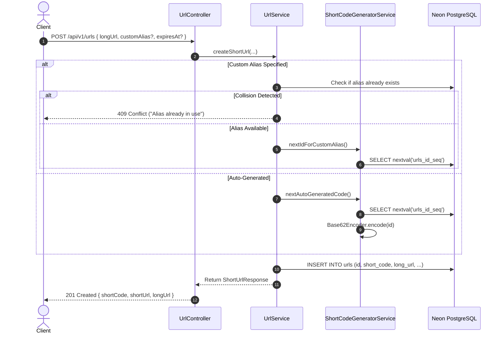
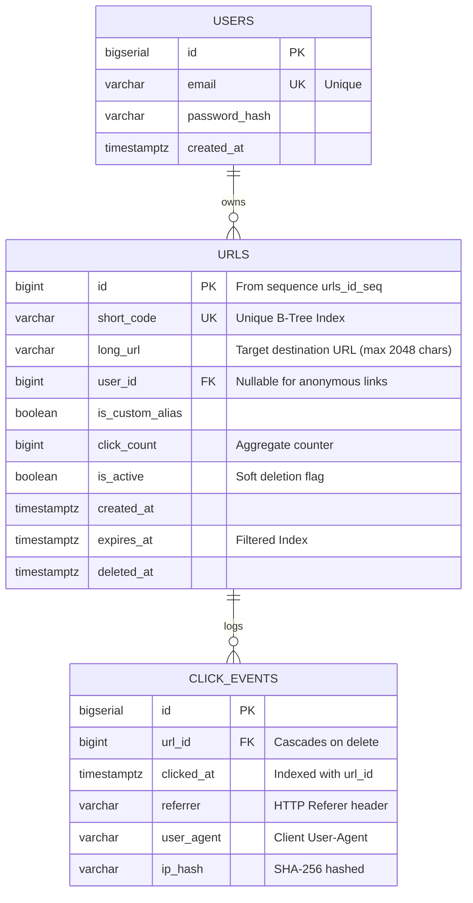

# ⚡ LinkSnip — High-Performance URL Shortener & Analytics

[](https://linksnip-sage.vercel.app/)
[](https://linksnip-t6fk.onrender.com)
[](https://linksnip-t6fk.onrender.com/swagger-ui.html)
[](https://adoptium.net)
[](https://spring.io/projects/spring-boot)
[](https://react.dev)

LinkSnip is a production-grade, distributed URL shortening service built with modern system design fundamentals. It combines low-latency redirect resolution via Redis caching, distributed token-bucket rate limiting, decoupled asynchronous click analytics, and an intuitive React + TypeScript frontend with live QR code generation and high-resolution PNG downloading.

---

## 🔗 Live Deployments

| Component | Provider | Live URL |
|---|---|---|
| **Frontend Application** | **Vercel** | [https://linksnip-sage.vercel.app/](https://linksnip-sage.vercel.app/) |
| **Backend REST API** | **Render** | [https://linksnip-t6fk.onrender.com](https://linksnip-t6fk.onrender.com) |
| **Interactive API Docs** | **Swagger UI** | [https://linksnip-t6fk.onrender.com/swagger-ui.html](https://linksnip-t6fk.onrender.com/swagger-ui.html) |
| **Health Check** | **Spring Actuator** | [https://linksnip-t6fk.onrender.com/actuator/health](https://linksnip-t6fk.onrender.com/actuator/health) |
| **Database** | **Neon.tech** | PostgreSQL 16 (Serverless, Lifetime Free) |
| **Cache & Limiter** | **Upstash** | Redis 7 over TLS (Serverless, Lifetime Free) |

---

## 📑 Table of Contents

- [Live Deployments](#-live-deployments)
- [System Architecture](#-system-architecture)
- [Key Flows & Sequence Diagrams](#-key-flows--sequence-diagrams)
  - [1. Redirection Flow (Read Path)](#1-redirection-flow-read-path)
  - [2. Short URL Creation Flow (Write Path)](#2-short-url-creation-flow-write-path)
- [System Design Highlights](#-system-design-highlights)
  - [Short Code Generation (Base62)](#short-code-generation-base62)
  - [Cache-Aside Pattern with Redis](#cache-aside-pattern-with-redis)
  - [Distributed Token-Bucket Rate Limiting](#distributed-token-bucket-rate-limiting)
  - [Non-blocking Asynchronous Analytics](#non-blocking-asynchronous-analytics)
  - [Privacy & GDPR-Compliant IP Hashing](#privacy--gdpr-compliant-ip-hashing)
- [Tech Stack](#-tech-stack)
- [Database Schema & Migrations](#-database-schema--migrations)
- [Frontend Features](#-frontend-features)
- [API Reference](#-api-reference)
- [Local Development & Docker](#-local-development--docker)

---

## 🏛️ System Architecture

```mermaid
flowchart TD
    subgraph Client["Presentation Tier (Vercel Global CDN)"]
        Browser["User Browser / Mobile Client"]
        Frontend["React 18 + Vite SPA"]
        QR["Client-Side HTML5 Canvas QR Generator"]
    end

    subgraph API["Application Tier (Render Web Service)"]
        RateLimit["RateLimitFilter (Bucket4j Token Bucket)"]
        Security["Stateless Security Filter Chain (CORS)"]
        RedirectCtrl["RedirectController (/{shortCode})"]
        UrlCtrl["UrlController (/api/v1/urls)"]
        UrlService["UrlService (Business Logic)"]
        CacheService["UrlCacheService (Cache-Aside Engine)"]
        ShortCodeService["ShortCodeGeneratorService (Base62 Sequence)"]
        AsyncAnalytics["ClickTrackingService (@Async Worker Pool)"]
    end

    subgraph Storage["Cloud Datastores (Lifetime Free)"]
        UpstashRedis[("Upstash Redis 7 over TLS\n- Redirect Cache (TTL 24h)\n- Rate-limit Buckets")]
        NeonPostgres[("Neon.tech PostgreSQL 16\n- urls\n- click_events\n- users")]
    end

    Browser -->|Visits App| Frontend
    Frontend -->|Generates Scannable QR| QR
    Frontend -->|POST /api/v1/urls| RateLimit
    Browser -->|GET /{shortCode} (Follow Short Link)| RateLimit

    RateLimit -->|Check & Consume Token| UpstashRedis
    RateLimit --> Security
    Security --> RedirectCtrl
    Security --> UrlCtrl

    RedirectCtrl --> UrlService
    UrlCtrl --> UrlService

    UrlService -->|1. Check Cache| CacheService
    CacheService <-->|Get / Put JSON Entry| UpstashRedis
    UrlService -->|2. Fallback Query| NeonPostgres
    UrlService -->|Next ID Sequence| ShortCodeService
    ShortCodeService <-->|PostgreSQL Sequence| NeonPostgres

    RedirectCtrl -.->|Non-blocking Async Dispatch| AsyncAnalytics
    AsyncAnalytics -->|Log Click Event & Increment Counter| NeonPostgres
```

---

## 🔄 Key Flows & Sequence Diagrams

### 1. Redirection Flow (Read Path)
Target latency for URL redirects is critical. LinkSnip uses the **Cache-Aside Pattern** and offloads click analytics to a background thread pool so clients receive an instant `302 Found` response.



---

### 2. Short URL Creation Flow (Write Path)



---

## 💡 System Design Highlights

### Short Code Generation (Base62)
- **Monotonically Increasing Sequence**: The database uses a dedicated sequence (`urls_id_seq START WITH 1000`).
- **Base62 Alphabet**: Characters `0-9`, `a-z`, `A-Z` (62 distinct alphanumeric characters).
- **Collision-Free Guaranteed**: Every ID maps bijectively to a unique Base62 string, eliminating hash collisions and expensive retry loops.
- **Scale Capacity**:
  - 6-character short code: $62^6 \approx 56.8\text{ billion}$ distinct URLs.
  - 7-character short code: $62^7 \approx 3.52\text{ trillion}$ distinct URLs.

### Cache-Aside Pattern with Redis
- **Key Pattern**: `linksnip:url:{shortCode}`
- **Payload**: JSON-serialized `UrlCacheEntry` containing `id`, `longUrl`, `active`, and `expiresAt`.
- **Dynamic TTL**:
  - Default TTL: **24 Hours**.
  - If a link has an expiration date (`expiresAt`), the TTL is capped to $\min(24\text{h}, \text{remaining\_time})$ to prevent caching expired links.
- **Cache Invalidation**: Explicit eviction occurs upon URL deletion or deactivation.

### Distributed Token-Bucket Rate Limiting
- Backed by **Bucket4j** over Redis via **Lettuce**.
- Configured limits:
  - **URL Creation**: 5 requests / 1 minute (anonymous)
  - **Redirect Lookup**: 100 requests / 1 minute (per IP)
- Rejection returns standard `429 Too Many Requests` with a `Retry-After` header.

### Non-blocking Asynchronous Analytics
- Click logging and counter incrementation run on a separate Spring `@Async("clickTrackingExecutor")` thread pool.
- User redirects resolve in $\approx 1\text{–}3\text{ ms}$ without being delayed by database write latency.

### Privacy & GDPR-Compliant IP Hashing
- Client IP addresses are never saved in plain text.
- One-way cryptographic SHA-256 hash using a server-side pepper:
  $$\text{ip\_hash} = \text{SHA-256}(\text{client\_ip} + \text{pepper})$$
- Ensures unique visitor analytics while maintaining strict GDPR privacy compliance.

---

## 🗄️ Database Schema & Migrations

Schema migrations are versioned and managed automatically by **Flyway**:



---

## 🎨 Frontend Features

The frontend is a lightweight Single Page Application (SPA) built with **React 18 + Vite + TypeScript + Tailwind CSS**:

- **Live Demo**: [https://linksnip-sage.vercel.app/](https://linksnip-sage.vercel.app/)
- **Client-Side QR Code Engine**:
  - Live QR code rendered in-browser using `qrcode.react`.
  - **1-Click PNG Download**: Converts HTML5 Canvas data directly into an image blob for instant download without hitting the server.
- **Copy with Confirmation**: One-click clipboard copy with visual feedback.
- **Dynamic Host Recognition**: Automatically formats preview paths using `window.location.host`.

---

## 🛠️ Tech Stack

| Tier | Component | Technology |
|---|---|---|
| **Frontend** | Framework & Bundler | React 18, TypeScript, Vite |
| | Styling | Tailwind CSS |
| | QR Code Generator | `qrcode.react` (HTML5 Canvas) |
| | Hosting | Vercel (Edge CDN) |
| **Backend** | Microservice Framework | Spring Boot 4.1.0, Java 21 |
| | Persistence | Spring Data JPA, Hibernate, PostgreSQL 16 |
| | Migrations | Flyway |
| | Caching & Rate Limiting | Redis 7 + Bucket4j + Lettuce |
| | Telemetry & Health | Spring Boot Actuator, Micrometer, Prometheus |
| | Hosting | Render (Docker Runtime) |
| **Datastores** | Relational Database | Neon.tech (Serverless PostgreSQL) |
| | Cache Store | Upstash (Serverless Redis over TLS) |

---

## 📡 API Reference

### 1. Create a Short Link
```bash
curl -X POST https://linksnip-t6fk.onrender.com/api/v1/urls \
  -H "Content-Type: application/json" \
  -d '{
    "longUrl": "https://en.wikipedia.org/wiki/System_architecture",
    "customAlias": "sys-arch"
  }'
```

**Response (`201 Created`):**
```json
{
  "shortCode": "sys-arch",
  "shortUrl": "https://linksnip-t6fk.onrender.com/sys-arch",
  "longUrl": "https://en.wikipedia.org/wiki/System_architecture",
  "createdAt": "2026-11-25T07:15:00Z"
}
```

---

### 2. Follow Redirect
```bash
curl -i https://linksnip-t6fk.onrender.com/sys-arch
```

**Response (`302 Found`):**
```http
HTTP/1.1 302 Found
Location: https://en.wikipedia.org/wiki/System_architecture
```

---

### 3. URL Details & Click Analytics
```bash
curl https://linksnip-t6fk.onrender.com/api/v1/urls/sys-arch
```

```bash
curl https://linksnip-t6fk.onrender.com/api/v1/urls/sys-arch/analytics
```
**Response (`200 OK`):**
```json
{
  "shortCode": "sys-arch",
  "totalClicks": 128,
  "clicksLast7Days": [
    { "date": "2026-11-24", "count": 52 },
    { "date": "2026-11-25", "count": 76 }
  ],
  "topReferrers": [
    { "referrer": "https://twitter.com", "count": 84 },
    { "referrer": "direct", "count": 44 }
  ]
}
```

---

## 💻 Local Development & Docker

### Option A: Full Stack with Docker Compose
```bash
# Clone the repository
git clone https://github.com/adarshagrawal14/LinkSnip.git
cd LinkSnip/url-shortener

# Start Backend, PostgreSQL & Redis
docker compose up --build
```
In a second terminal:
```bash
cd LinkSnip/url-shortener-frontend
npm install
npm run dev
```
Open **`http://localhost:3000`** in your browser.

---

### Option B: Local Spring Boot Run
```bash
# 1. Start only database & Redis
cd url-shortener
docker compose up postgres redis

# 2. Run Spring Boot locally
./mvnw spring-boot:run

# 3. Run Frontend
cd ../url-shortener-frontend
npm run dev
```

---

## 📄 License
This project is open-source and available under the [MIT License](LICENSE).
