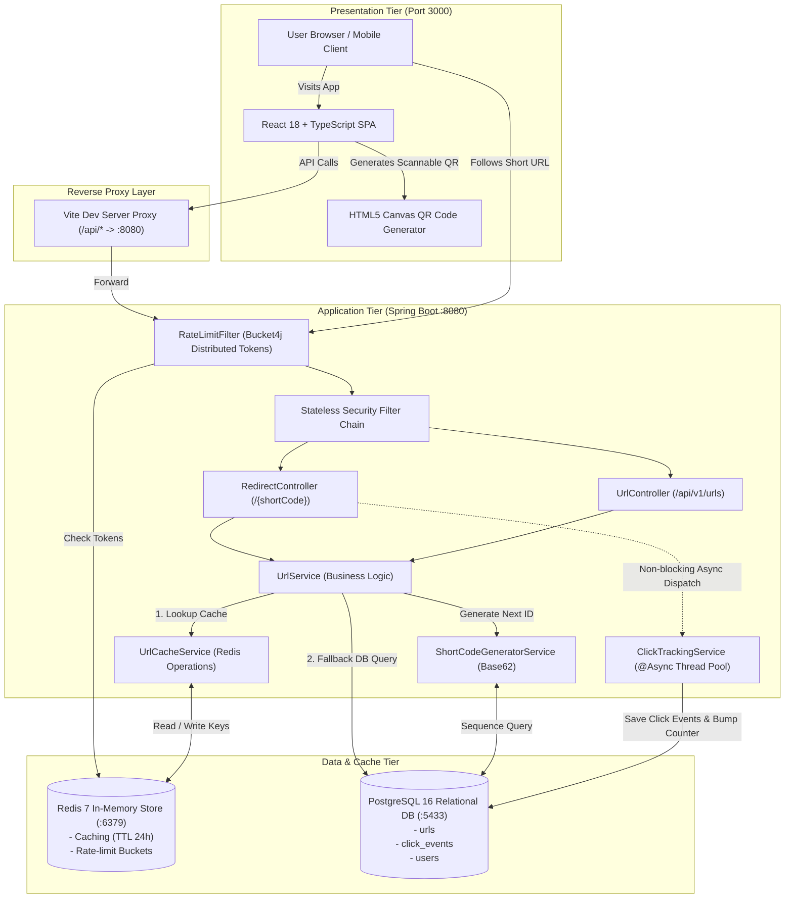
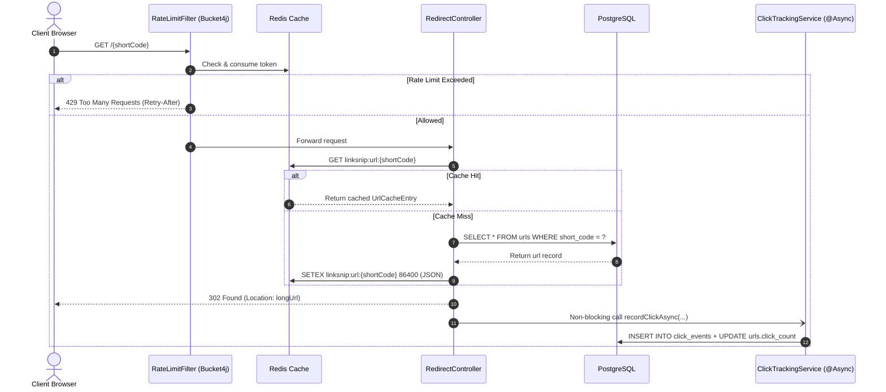
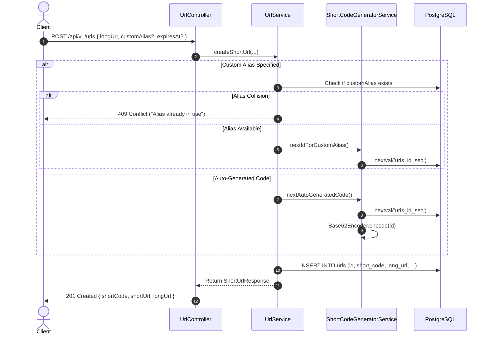
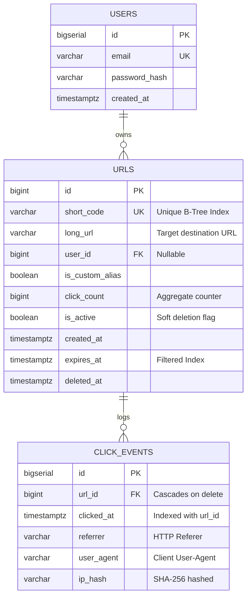

# ⚡ LinkSnip — Full-Stack URL Shortener & Analytics

LinkSnip is a modern, production-grade URL shortening platform designed around real-world system design principles. It features sub-millisecond redirect resolution powered by Redis caching, distributed token-bucket rate limiting, decoupled asynchronous click analytics, and a responsive React + TypeScript frontend with client-side QR code generation and high-resolution PNG downloading.

---

## 📑 Table of Contents

- [Repository Structure](#-repository-structure)
- [System Architecture](#-system-architecture)
- [End-to-End Request Flows](#-end-to-end-request-flows)
  - [1. Redirection Flow (Read Path)](#1-redirection-flow-read-path)
  - [2. Short URL Creation Flow (Write Path)](#2-short-url-creation-flow-write-path)
- [System Design Highlights](#-system-design-highlights)
  - [Base62 Sequence Encoding](#base62-sequence-encoding)
  - [Cache-Aside Caching with Redis](#cache-aside-caching-with-redis)
  - [Distributed Token-Bucket Rate Limiting](#distributed-token-bucket-rate-limiting)
  - [Non-blocking Asynchronous Analytics](#non-blocking-asynchronous-analytics)
  - [GDPR-Compliant IP Anonymization](#gdpr-compliant-ip-anonymization)
- [Database Schema & Migrations](#-database-schema--migrations)
- [Frontend Features & Architecture](#-frontend-features--architecture)
- [Tech Stack](#-tech-stack)
- [API Reference](#-api-reference)
- [Getting Started & Setup](#-getting-started--setup)
  - [Prerequisites](#prerequisites)
  - [Option A: Docker (Recommended)](#option-a-docker-recommended)
  - [Option B: Local Development](#option-b-local-development)
- [Configuration & Environment Variables](#-configuration--environment-variables)
- [Troubleshooting & FAQ](#-troubleshooting--faq)

---

## 📂 Repository Structure

The workspace is organized into two standalone, decoupled services:

```
untitled folder/
├── README.md                      # Complete project documentation (this file)
│
├── url-shortener/                 # Backend Service (Spring Boot 4.1 + Java 21)
│   ├── Dockerfile                 # Multi-stage Maven container build
│   ├── docker-compose.yml         # Orchestration for App, PostgreSQL 16 & Redis 7
│   ├── pom.xml                    # Maven dependencies & plugins
│   ├── .env.example               # Environment variables template
│   └── src/
│       ├── main/
│       │   ├── java/com/linksnip/urlshortener/
│       │   │   ├── LinksnipApplication.java     # Spring Boot Entrypoint
│       │   │   ├── config/                      # Security, Redis, Async, OpenAPI, RateLimit
│       │   │   ├── controller/                  # Redirect, URL, Analytics & Auth Controllers
│       │   │   ├── dto/                         # Request & Response Records
│       │   │   ├── entity/                      # JPA Entities (Url, ClickEvent, User)
│       │   │   ├── repository/                  # Spring Data Repositories
│       │   │   ├── service/                     # Business logic, Caching, Analytics, Base62
│       │   │   └── util/                        # Base62Encoder, IpHashUtil
│       │   └── resources/
│       │       ├── application.yml              # Default config
│       │       ├── application-docker.yml       # Docker profile overrides
│       │       └── db/migration/                # Flyway V1, V2, V3 SQL scripts
│       └── test/                                # Unit, MockMvc & Testcontainers tests
│
└── url-shortener-frontend/        # Frontend Client (React 18 + Vite + TypeScript)
    ├── package.json               # Node dependencies (react-router-dom, axios, qrcode.react)
    ├── vite.config.ts             # Dev server & reverse proxy configuration
    ├── tailwind.config.js         # Custom theme colors (brand palette)
    ├── tsconfig.json              # TypeScript compiler settings
    └── src/
        ├── App.tsx                # Main router setup
        ├── api.ts                 # Axios API client configured for backend proxy
        ├── components/
        │   ├── Navbar.tsx         # Responsive header component
        │   └── QrModal.tsx        # Live QR Code generator & PNG download modal
        └── pages/
            └── HomePage.tsx       # Interactive URL shortener interface
```

---

## 🏛️ System Architecture



---

## 🔄 End-to-End Request Flows

### 1. Redirection Flow (Read Path)
Designed for ultra-low latency. Redirect requests are answered in single-digit milliseconds by serving straight from Redis, while event tracking is offloaded asynchronously:



---

### 2. Short URL Creation Flow (Write Path)



---

## 💡 System Design Highlights

### Base62 Sequence Encoding
- **Database Sequence**: Driven by PostgreSQL's `urls_id_seq` starting at 1000.
- **Bijective Character Set**: Digits `[0-9]`, lowercase `[a-z]`, and uppercase `[A-Z]` (62 alphanumeric characters).
- **Collision-Free**: Unlike hash-truncation schemes (like MD5 or CRC32) that suffer from birthday paradox collisions, sequence-based Base62 provides a deterministic $1:1$ bijection with **zero collisions**.
- **URL Safety**: No symbols requiring percent-encoding (`/`, `?`, `&`, `#`).

### Cache-Aside Caching with Redis
- **Key Pattern**: `linksnip:url:{shortCode}`
- **Payload**: JSON serialized `UrlCacheEntry` (`id`, `longUrl`, `active`, `expiresAt`).
- **Dynamic TTL**:
  - Default TTL: **24 hours**.
  - If a link expires within 24 hours, TTL is computed as $\min(24\text{h}, \text{remaining\_time})$ to eliminate serving stale links.
- **Eviction on Modification**: Deleting or deactivating a URL immediately issues a Redis `DEL` command.

### Distributed Token-Bucket Rate Limiting
- Backed by **Bucket4j** over Redis via **Lettuce**.
- Configured tiers:
  - **Create Short URL**: 5 requests / 1 min (anonymous)
  - **Redirect Lookups**: 100 requests / 1 min (per IP)
- Atomic token consumption ensures rate limits stay consistent across multiple scaled backend instances.

### Non-blocking Asynchronous Analytics
- Capturing click events, user agents, referrers, and updating counter columns is executed on a dedicated Spring `@Async("clickTrackingExecutor")` thread pool.
- Ensures user redirects remain instant and completely decoupled from database latency or temporary database locks.

### GDPR-Compliant IP Anonymization
- Visitor IP addresses are never saved in plain text.
- Salted SHA-256 hash using a server-side pepper:
  $$\text{ip\_hash} = \text{SHA-256}(\text{client\_ip} + \text{pepper})$$
- Enables unique visitor metrics while adhering strictly to global data protection regulations.

---

## 🗄️ Database Schema & Migrations

Database schema versioning is managed via **Flyway**:



---

## 🎨 Frontend Features & Architecture

The frontend is a lightweight Single Page Application (SPA) designed with **React 18 + TypeScript + Tailwind CSS**:

- **Real-Time Validation**: Validates URL structure and protocol before dispatching network calls.
- **Interactive QR Code Generator**:
  - Displays a crisp, scannable QR code generated client-side via `qrcode.react`.
  - **Download PNG Button**: Converts HTML5 Canvas data directly into an image blob and triggers browser download without round-trips to the server.
- **Copy to Clipboard**: Instant clipboard copy with visual confirmation.
- **Vite Proxy Integration**: Seamlessly proxies API calls to `localhost:8080`, eliminating CORS restrictions during local development.

---

## 🛠️ Tech Stack

| Layer | Component | Description |
|---|---|---|
| **Frontend** | React 18, TypeScript, Vite, Tailwind CSS | Modern, responsive, type-safe interface |
| **QR Code** | `qrcode.react` (HTML5 Canvas) | Zero-latency client-side QR generation & PNG export |
| **Backend** | Spring Boot 4.1 (Java 21) | RESTful API services & application logic |
| **Persistence** | Spring Data JPA, Hibernate, PostgreSQL 16 | Relational datastore & ORM |
| **Migrations** | Flyway | Structured database schema versioning |
| **Caching** | Redis 7 + Spring Data Redis | High-speed redirect caching |
| **Rate Limiter** | Bucket4j + Lettuce | Distributed token-bucket rate limiting |
| **Metrics** | Micrometer, Spring Boot Actuator | Prometheus-compatible telemetry |
| **Containers** | Docker & Docker Compose | Multi-container reproducible development and deployment |

---

## 📡 API Reference

### 1. Create a Short Link
```http
POST /api/v1/urls
Content-Type: application/json
```
**Request:**
```json
{
  "longUrl": "https://en.wikipedia.org/wiki/URL_shortening",
  "customAlias": "wiki-shortener",
  "expiresAt": "2027-12-31T23:59:59Z"
}
```
*(Note: `customAlias` and `expiresAt` are optional)*

**Response (`201 Created`):**
```json
{
  "shortCode": "wiki-shortener",
  "shortUrl": "http://localhost:8080/wiki-shortener",
  "longUrl": "https://en.wikipedia.org/wiki/URL_shortening",
  "createdAt": "2026-11-24T15:40:00Z",
  "expiresAt": "2027-12-31T23:59:59Z"
}
```

---

### 2. Follow Short URL Redirect
```http
GET /{shortCode}
```
**Response (`302 Found`):**
```http
HTTP/1.1 302 Found
Location: https://en.wikipedia.org/wiki/URL_shortening
```

---

### 3. Retrieve URL Details
```http
GET /api/v1/urls/{shortCode}
```
**Response (`200 OK`):**
```json
{
  "shortCode": "wiki-shortener",
  "shortUrl": "http://localhost:8080/wiki-shortener",
  "longUrl": "https://en.wikipedia.org/wiki/URL_shortening",
  "createdAt": "2026-11-24T15:40:00Z",
  "expiresAt": "2027-12-31T23:59:59Z",
  "clickCount": 42,
  "active": true
}
```

---

### 4. Click Analytics
```http
GET /api/v1/urls/{shortCode}/analytics
```
**Response (`200 OK`):**
```json
{
  "shortCode": "wiki-shortener",
  "totalClicks": 42,
  "clicksLast7Days": [
    { "date": "2026-11-23", "count": 18 },
    { "date": "2026-11-24", "count": 24 }
  ],
  "topReferrers": [
    { "referrer": "https://github.com", "count": 30 },
    { "referrer": "direct", "count": 12 }
  ]
}
```

---

## 🚀 Getting Started & Setup

### Prerequisites
- **Docker Desktop**: [Download Docker](https://www.docker.com/products/docker-desktop)
- **Node.js (v20+)**: [Download Node.js](https://nodejs.org)
- **Java 21** *(Optional, only if running backend outside Docker)*

---

### Option A: Docker (Recommended)

1. **Start Backend, PostgreSQL, and Redis:**
   ```bash
   cd url-shortener
   docker compose up --build
   ```
   - API server: `http://localhost:8080`
   - Swagger Documentation: `http://localhost:8080/swagger-ui.html`
   - Actuator Healthcheck: `http://localhost:8080/actuator/health`

2. **Start Frontend:**
   ```bash
   cd ../url-shortener-frontend
   npm install
   npm run dev
   ```
   Open **`http://localhost:3000`** in your browser.

---

### Option B: Local Development

If you prefer building and running Spring Boot with your local JDK:

1. **Start Datastores:**
   ```bash
   cd url-shortener
   docker compose up postgres redis
   ```

2. **Run Spring Boot:**
   ```bash
   cd url-shortener
   ./mvnw spring-boot:run
   ```

3. **Run Frontend:**
   ```bash
   cd ../url-shortener-frontend
   npm install
   npm run dev
   ```

---

## ⚙️ Configuration & Environment Variables

Default variables configured in `url-shortener/docker-compose.yml` and `.env.example`:

| Variable | Default Value | Description |
|---|---|---|
| `DB_NAME` | `linksnip` | PostgreSQL database name |
| `DB_USERNAME` | `linksnip` | Database superuser |
| `DB_PASSWORD` | `linksnip` | Database password |
| `DB_PORT` | `5433` | Host port for Postgres (avoids clashing with local 5432) |
| `REDIS_HOST` | `localhost` / `redis` | Redis hostname |
| `REDIS_PORT` | `6379` | Redis port |
| `SERVER_PORT` | `8080` | Spring Boot HTTP port |
| `APP_BASE_URL` | `http://localhost:8080` | Host URL prefix for generated short links |
| `IP_HASH_PEPPER` | `dev-only-pepper-change-me` | Salt pepper for GDPR IP hashing |

---

## ❓ Troubleshooting & FAQ

- **Port 5433 Conflict**: If port 5433 is in use, modify `DB_PORT` in `.env` and `docker-compose.yml`.
- **Node `brotli` dylib issue on macOS**: If Homebrew Node reports a missing `brotli` library, run `brew install brotli` or `brew reinstall node`.
- **Resetting Database**:
  ```bash
  docker compose down -v
  docker compose up --build
  ```
