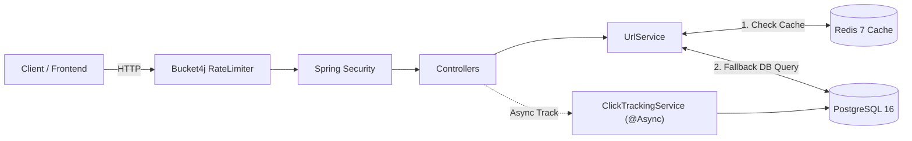

# ⚡ LinkSnip — Backend Service

[](https://linksnip-sage.vercel.app/)
[](https://linksnip-t6fk.onrender.com)
[](https://linksnip-t6fk.onrender.com/swagger-ui.html)
[](https://adoptium.net)
[](https://spring.io/projects/spring-boot)

The backend service for **LinkSnip**, a high-performance URL shortener built with Java 21, Spring Boot 4.1, PostgreSQL 16, and Redis 7.

---

## 🔗 Live Endpoints

- **API Base**: [https://linksnip-t6fk.onrender.com](https://linksnip-t6fk.onrender.com)
- **Interactive Swagger Documentation**: [https://linksnip-t6fk.onrender.com/swagger-ui.html](https://linksnip-t6fk.onrender.com/swagger-ui.html)
- **Actuator Health**: [https://linksnip-t6fk.onrender.com/actuator/health](https://linksnip-t6fk.onrender.com/actuator/health)

---

## 🏛️ Architecture & System Design



### Key Capabilities:
- **Base62 Sequence Encoding**: Monotonically increasing database sequence ensures 100% collision-free short codes.
- **Cache-Aside Pattern (Redis)**: Sub-millisecond redirects with dynamic TTL matching link expiry.
- **Distributed Token-Bucket Rate Limiter**: Per-IP limits using Bucket4j and Lettuce.
- **Asynchronous Click Analytics**: Non-blocking event logging using Spring `@Async` threads.
- **GDPR IP Hashing**: Salted SHA-256 IP hashing protects visitor privacy.

---

## 📡 API Reference

| Method | Endpoint | Description |
|---|---|---|
| `POST` | `/api/v1/urls` | Create a short URL (`longUrl`, optional `customAlias`, optional `expiresAt`) |
| `GET` | `/{shortCode}` | Follow short URL redirect (`302 Found`) |
| `GET` | `/api/v1/urls/{shortCode}` | Fetch details of a short link |
| `GET` | `/api/v1/urls/{shortCode}/analytics` | Click count and referrer statistics |
| `DELETE` | `/api/v1/urls/{shortCode}` | Soft-delete / deactivate a short link |
| `GET` | `/actuator/health` | Service health status |

---

## 🛠️ Quick Start

```bash
docker compose up --build
```
API is available at `http://localhost:8080`.
