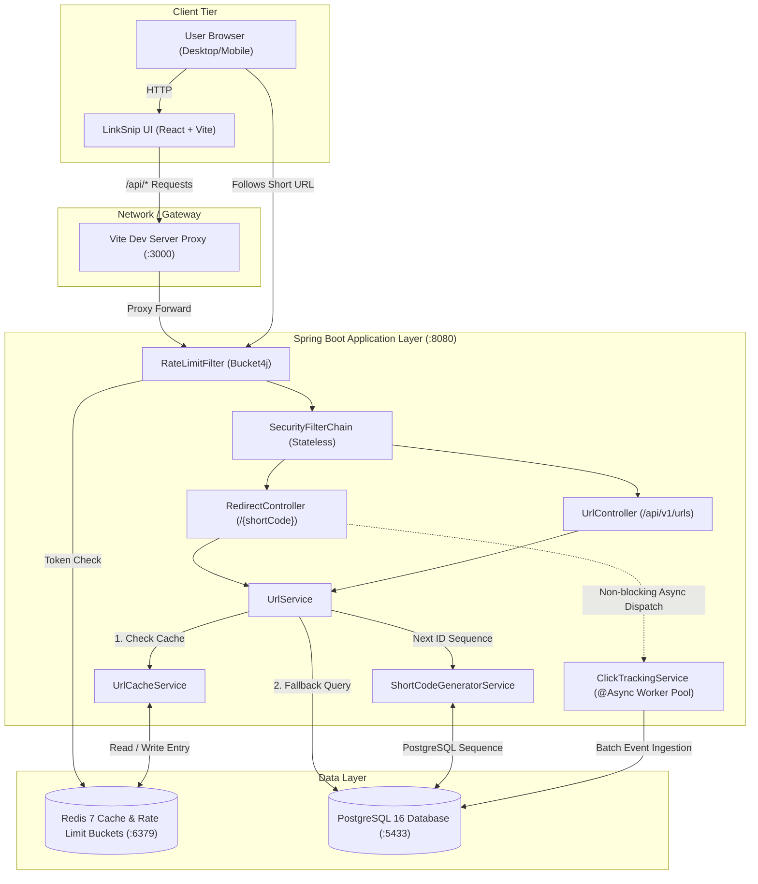
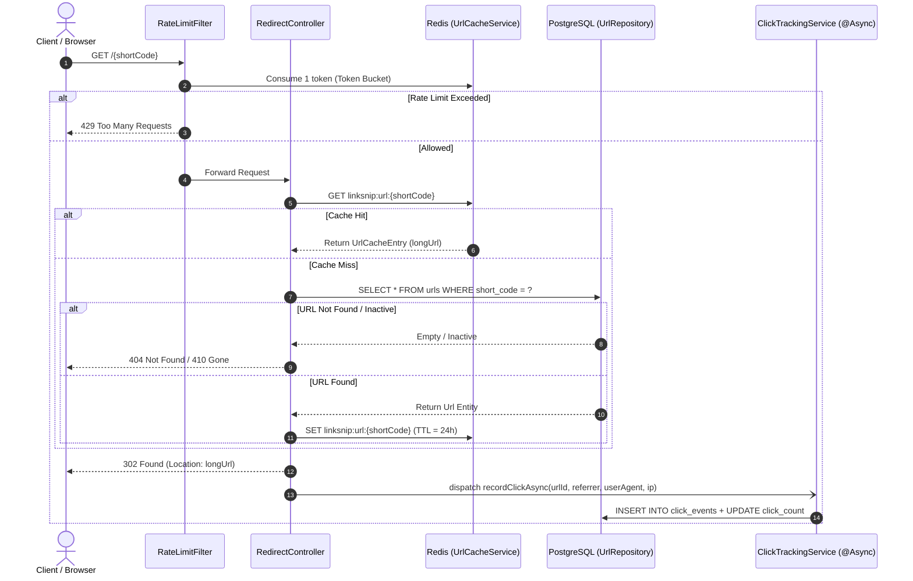
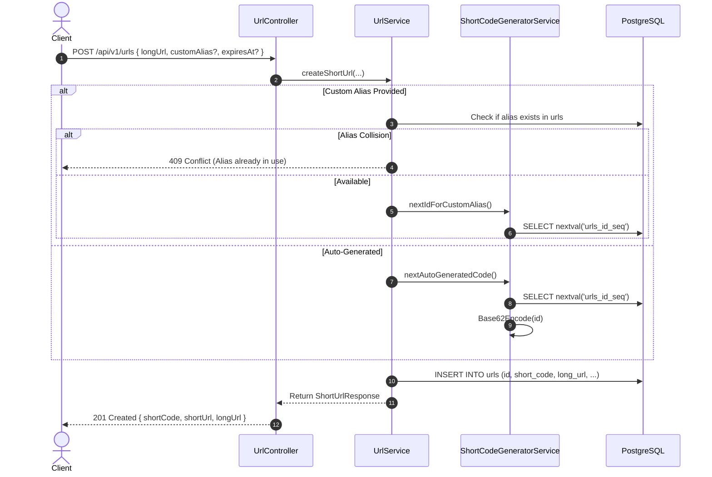
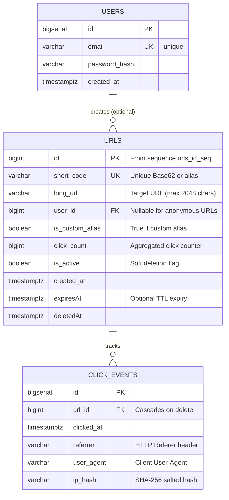

# LinkSnip — High-Performance URL Shortener & Analytics

LinkSnip is a production-grade, distributed URL shortening service built with modern system design fundamentals. It combines low-latency redirect resolution via Redis caching, distributed rate limiting, decoupled asynchronous click analytics, and an intuitive React + TypeScript frontend with live QR code generation and download capabilities.

---

## 📑 Table of Contents

- [System Architecture](#-system-architecture)
- [Key Flows & Sequence Diagrams](#-key-flows--sequence-diagrams)
  - [1. Redirection (Read Path)](#1-redirection-read-path)
  - [2. URL Creation (Write Path)](#2-url-creation-write-path)
- [System Design Highlights](#-system-design-highlights)
  - [Short Code Generation](#short-code-generation-base62)
  - [Cache-Aside Strategy with Redis](#cache-aside-strategy-with-redis)
  - [Distributed Token-Bucket Rate Limiting](#distributed-token-bucket-rate-limiting)
  - [Asynchronous Click Analytics Pipeline](#asynchronous-click-analytics-pipeline)
  - [Privacy & GDPR-Compliant IP Hashing](#privacy--gdpr-compliant-ip-hashing)
- [Tech Stack](#-tech-stack)
- [Data Model & Schema](#-data-model--schema)
- [Frontend Architecture](#-frontend-architecture)
- [API Reference](#-api-reference)
- [Observability & Metrics](#-observability--metrics)
- [Quick Start & Setup](#-quick-start--setup)
  - [Docker Setup (Recommended)](#option-a-docker-compose-full-stack)
  - [Local Development](#option-b-local-development)

---

## 🏛️ System Architecture

The following diagram illustrates the component architecture across the presentation tier, API layer, caching layer, and persistent database:



---

## 🔄 Key Flows & Sequence Diagrams

### 1. Redirection (Read Path)
Target latency for URL redirects is critical. LinkSnip uses the **Cache-Aside Pattern** and offloads click tracking to an asynchronous background worker pool so the client receives an immediate `302 Found` response.



---

### 2. URL Creation (Write Path)
When creating a short URL, the system supports both automated Base62 short-code generation and user-specified custom aliases.



---

## 💡 System Design Highlights

### Short Code Generation (Base62)
- **Monotonically Increasing Sequence**: The database uses a dedicated 64-bit sequence (`urls_id_seq START WITH 1000`).
- **Base62 Character Set**: `[0-9a-zA-Z]` (62 symbols) ensures compact, URL-safe strings without confusing characters or symbols needing percent-encoding.
- **Bijective & Reversible**: Every unique integer ID maps to a unique short code with **zero collision risk**, eliminating the need for expensive retry loops or hash collision resolution.
- **Capacity**:
  - 6-character code: $62^6 \approx 56.8\text{ billion}$ distinct links.
  - 7-character code: $62^7 \approx 3.52\text{ trillion}$ distinct links.

### Cache-Aside Strategy with Redis
- **Key Schema**: `linksnip:url:{shortCode}`
- **Payload**: Serialized JSON `UrlCacheEntry` containing `id`, `longUrl`, `active`, and `expiresAt`.
- **Dynamic TTL**:
  - Default TTL: **24 Hours**.
  - If URL has a defined expiration (`expiresAt`), TTL is capped to `min(24h, remaining_duration)` to prevent caching expired links.
- **Cache Invalidation**: Explicit eviction on URL deletion or deactivation guarantees consistency.

### Distributed Token-Bucket Rate Limiting
- Built using **Bucket4j** integrated with **Lettuce** and Redis backing.
- Rate limit buckets are tracked per IP and tier:
  - **Anonymous URL Creation**: 5 requests / minute
  - **Redirect Lookup**: 100 requests / minute
- When exhausted, returns standard `429 Too Many Requests` with a `Retry-After` header.

### Asynchronous Click Analytics Pipeline
- Database write operations on the redirect path can cause severe bottlenecks under high traffic.
- LinkSnip offloads click recording using Spring's `@Async("clickTrackingExecutor")` thread pool:
  - Captures `referrer`, `userAgent`, and `ipHash`.
  - Atomically increments aggregate `click_count` on the `urls` record.
  - Failures in logging metrics do **not** affect or delay the user's redirect.

### Privacy & GDPR-Compliant IP Hashing
- Client IP addresses are not stored as plain text.
- LinkSnip computes a one-way cryptographic SHA-256 hash using a server-side pepper:
  $$\text{ip\_hash} = \text{SHA-256}(\text{client\_ip} + \text{pepper})$$
- Allows unique visitor counting and anomaly detection while maintaining user privacy and GDPR compliance.

---

## 🛠️ Tech Stack

| Layer | Technology | Purpose |
|---|---|---|
| **Frontend Framework** | React 18, TypeScript, Vite | Fast, type-safe single-page application |
| **Styling** | Tailwind CSS | Modern, responsive utility-first UI |
| **QR Code Engine** | `qrcode.react` (HTML5 Canvas) | Zero-latency, browser-native QR code rendering & download |
| **Backend Framework** | Spring Boot 4.1 (Java 21) | RESTful microservice & business logic |
| **Persistence** | Spring Data JPA / Hibernate | Object-relational mapping and repository layer |
| **Migration** | Flyway | Versioned database schema evolution |
| **Cache & Limiter** | Redis 7 + Bucket4j | Sub-millisecond lookup cache & token-bucket rate limiting |
| **Primary Database** | PostgreSQL 16 | ACID-compliant relational data storage |
| **Instrumentation** | Micrometer + Spring Actuator | Prometheus-compatible telemetry & health metrics |

---

## 🗄️ Data Model & Schema

LinkSnip employs versioned schema migrations managed by **Flyway**:



### Indexed Optimization:
- `idx_urls_short_code`: Unique B-Tree index on `urls(short_code)` for $O(1)$ lookups.
- `idx_urls_expires_at`: Partial index on `urls(expires_at) WHERE expires_at IS NOT NULL` for background cleanup jobs.
- `idx_click_events_url_id_clicked_at`: Composite index on `click_events(url_id, clicked_at)` for analytics aggregation queries.

---

## 🖥️ Frontend Architecture

The frontend is located in `url-shortener-frontend/` and provides a clean, single-page application experience:

- **State Management & Form Handling**: Immediate client-side validation of URLs (`http://` / `https://` checking).
- **Reverse Proxy**: Vite proxy configured in `vite.config.ts` transparently routes `/api/*` and redirect requests to `localhost:8080`, avoiding CORS complications in development.
- **Client-Side QR Generation**:
  - `QrModal.tsx` renders an SVG/Canvas element locally using the short link destination.
  - **PNG Downloader**: Converts the HTML5 Canvas directly into a data URL blob and triggers a native download prompt without server involvement.

---

## 📡 API Reference

### 1. Create Short URL
```http
POST /api/v1/urls
Content-Type: application/json
```
**Request Body:**
```json
{
  "longUrl": "https://developer.mozilla.org/en-US/docs/Web/API",
  "customAlias": "mdn-api",
  "expiresAt": "2027-01-01T00:00:00Z"
}
```
*Note: `customAlias` and `expiresAt` are optional.*

**Response (`201 Created`):**
```json
{
  "shortCode": "mdn-api",
  "shortUrl": "http://localhost:8080/mdn-api",
  "longUrl": "https://developer.mozilla.org/en-US/docs/Web/API",
  "createdAt": "2026-11-24T15:40:00Z",
  "expiresAt": "2027-01-01T00:00:00Z"
}
```

---

### 2. Follow Redirect
```http
GET /{shortCode}
```
**Response (`302 Found`):**
```http
HTTP/1.1 302 Found
Location: https://developer.mozilla.org/en-US/docs/Web/API
```

---

### 3. URL Details & Analytics
```http
GET /api/v1/urls/{shortCode}
```
**Response (`200 OK`):**
```json
{
  "shortCode": "mdn-api",
  "shortUrl": "http://localhost:8080/mdn-api",
  "longUrl": "https://developer.mozilla.org/en-US/docs/Web/API",
  "createdAt": "2026-11-24T15:40:00Z",
  "expiresAt": "2027-01-01T00:00:00Z",
  "clickCount": 142,
  "active": true
}
```

```http
GET /api/v1/urls/{shortCode}/analytics
```
**Response (`200 OK`):**
```json
{
  "shortCode": "mdn-api",
  "totalClicks": 142,
  "clicksLast7Days": [
    { "date": "2026-11-23", "count": 68 },
    { "date": "2026-11-24", "count": 74 }
  ],
  "topReferrers": [
    { "referrer": "https://twitter.com", "count": 94 },
    { "referrer": "direct", "count": 48 }
  ]
}
```

---

## 📊 Observability & Metrics

LinkSnip exposes Prometheus-compatible metrics through Spring Boot Actuator at `http://localhost:8080/actuator/prometheus`:

- `urlshortener.redirect.latency`: Timer recording end-to-end resolution latency.
- `urlshortener.cache.requests`: Counter tagged with `result="hit"` or `result="miss"`.
- `actuator/health`: Container health check verification for Docker orchestration.

---

## 🚀 Quick Start & Setup

### Option A: Docker Compose (Full Stack)

Ensure **Docker Desktop** is running, then execute:

```bash
cd url-shortener
docker compose up --build
```
This automatically initializes:
- **PostgreSQL 16** on `localhost:5433`
- **Redis 7** on `localhost:6379`
- **LinkSnip Spring Boot App** on `localhost:8080`

In a separate terminal, launch the frontend:
```bash
cd url-shortener-frontend
npm install
npm run dev
```
Open **`http://localhost:3000`** in your browser.

---

### Option B: Local Development

If developing on the backend locally with Java 21:

1. **Spin up datastores:**
   ```bash
   cd url-shortener
   docker compose up postgres redis
   ```

2. **Run Spring Boot:**
   ```bash
   cd url-shortener
   ./mvnw spring-boot:run
   ```

3. **Run Frontend:**
   ```bash
   cd url-shortener-frontend
   npm run dev
   ```
